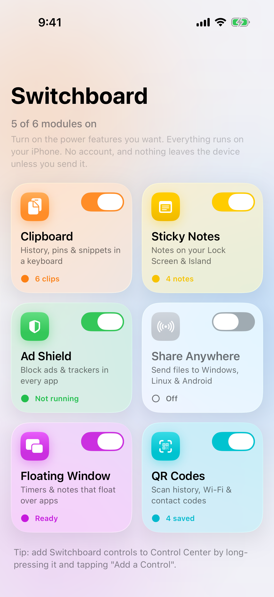
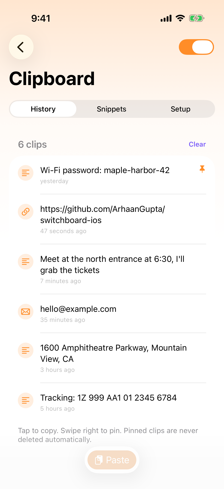
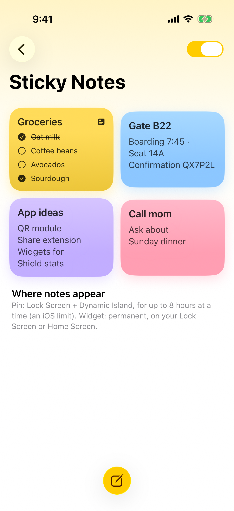
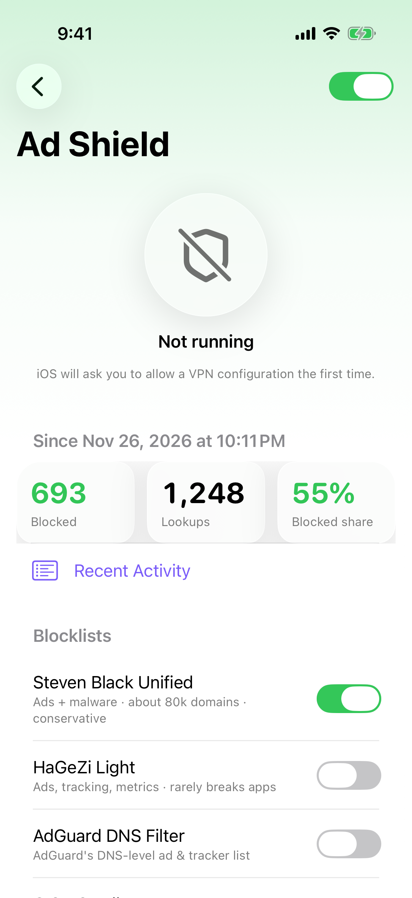
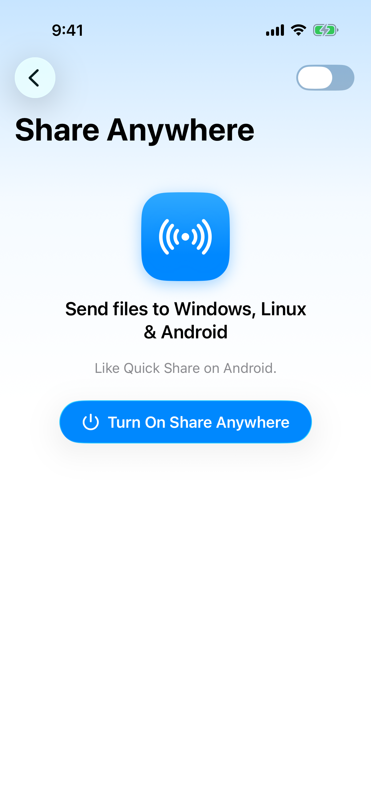
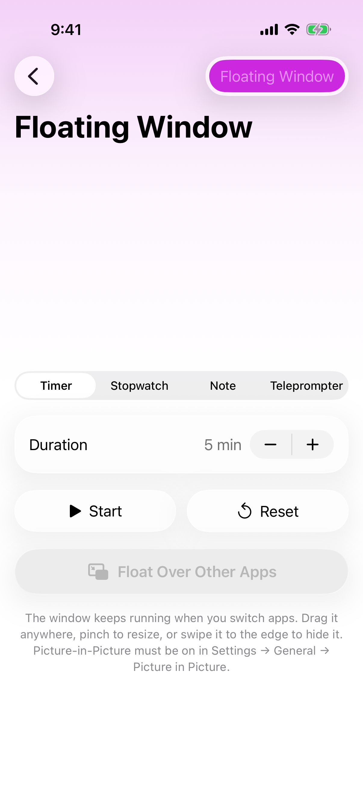
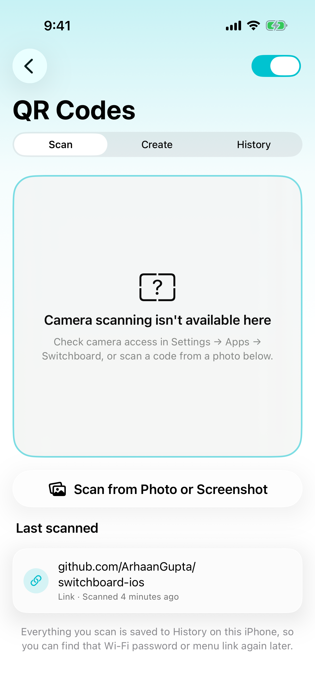

# Switchboard

[](https://github.com/ArhaanGupta/switchboard-ios/actions/workflows/ci.yml)


[](LICENSE)

**Android-style power features for iPhone, in one app, each one switchable on or off.**

Inspired by [Essentials](https://github.com/sameerasw/essentials) for Android. Every feature is a *module*, and you turn on only the ones you want. Built for iOS 26+ with SwiftUI and Liquid Glass.

| Module | What it does | Android equivalent | How it works on iOS |
|---|---|---|---|
| **Clipboard** | Clipboard history, pinned clips, snippets with `{date}`/`{clipboard}` tokens | Gboard clipboard | Custom keyboard extension (captures while visible) + Paste button + Control Center control |
| **Sticky Notes** | Notes & checklists on the Lock Screen, Dynamic Island and widgets; tick items without opening the app | Persistent notifications | Live Activity + interactive WidgetKit widget + App Intents |
| **Ad Shield** | Blocks ad/tracker domains in **every app**, with blocklists, allow/block rules and a live log | Private DNS / AdGuard | On-device DNS-only packet tunnel (Network Extension) |
| **Share Anywhere** | Send/receive files with Windows, Linux, macOS and Android, including straight from the share sheet | Quick Share | Implements the open [LocalSend protocol](https://github.com/localsend/protocol) + share extension |
| **Floating Window** | Timer, stopwatch, note or teleprompter floating over other apps | Bubbles / floating windows | Picture-in-Picture fed by a live-rendered SwiftUI view |
| **QR Codes** | Scan history, scan from photos, create Wi-Fi / contact / link codes | Wi-Fi QR sharing | VisionKit live scanner + Vision + Core Image |
| **App Lock** | Face ID on any app or category, auto re-lock after 15 min–2 h | App lock | Screen Time APIs (FamilyControls, ManagedSettings, DeviceActivity). iOS enforces the lock, with zero background work |

## Screenshots

| Home | Clipboard | Sticky Notes |
|---|---|---|
|  |  |  |
| **Ad Shield** | **Share Anywhere** | **Floating Window** |
|  |  |  |
| **QR Codes** | **App Lock** | |
|  |  | |

*Captured automatically by the UI tests in CI.*

iOS 26/27 already covers spam call screening, call recording, battery charge limits, duplicate photo detection and ZIP files, so Switchboard leaves those out.

## Build without a Mac (GitHub Actions)

Push this repo to GitHub. The **CI** workflow (`.github/workflows/ci.yml`) runs on Apple's macOS runners and:

1. runs the `SwitchboardKit` unit tests (`swift test`)
2. generates the Xcode project with XcodeGen and builds the app plus all 3 extensions for the iOS Simulator

You need a Mac (or a cloud Mac) only to install the app on a real iPhone or to submit it to the App Store.

## Build on a Mac

```bash
brew install xcodegen
xcodegen generate
open Switchboard.xcodeproj
```

Then in `project.yml` (re-run `xcodegen generate` afterwards):

- set `DEVELOPMENT_TEAM` to your Apple Team ID
- change `BASE_BUNDLE_ID` and `APP_GROUP_ID` to identifiers you own

### Capabilities you need (paid Apple Developer account)

| Capability | Used by | Notes |
|---|---|---|
| App Groups | all targets | Shares data between the app, keyboard, widgets and tunnel |
| Network Extensions → Packet Tunnel | app + Shield | Ad Shield |
| Family Controls | app + 3 App Lock extensions | App Lock. Works for development right away; App Store distribution needs Apple's approval (request it at developer.apple.com/contact/request/family-controls-distribution) |
| Multicast Networking *(optional)* | app | Faster LocalSend discovery. Request it at developer.apple.com/contact/request/networking-multicast, then add `com.apple.developer.networking.multicast` to the app's entitlements. Without it, Switchboard scans the subnet instead |

## Architecture

```
Packages/SwitchboardKit/        Pure Swift logic, unit tested
  SwitchboardCore               ModuleID, FeatureFlags, App Group storage, sticky notes store
  ClipboardCore                 Clipboard history store, snippets, template tokens
  ShieldCore                    DNS parser/responder, IPv4/UDP packets, blocklist parser, stats
  LocalSendCore                 LocalSend models, HTTP parser, receive sessions, LocalSendClient
  QRCore                        QR payload encoding/parsing (Wi-Fi, vCard, links) and history
App/                            SwiftUI app (home grid + one screen per module)
Shared/                         Code compiled into both app and widgets (deep links, Live Activity, intents)
Extensions/Keyboard             Clipboard keyboard
Extensions/Widgets              Sticky note widget, Live Activity, Control Center controls
Extensions/Shield               DNS filtering packet tunnel
Extensions/ShareExtension       "Send with Switchboard" share sheet
Extensions/AppLock*             Lock screen UI, its button handler, and the re-lock timer
Shared/AppLock                  App Lock engine shared by the app and its extensions
UITests/                        Launches the app, opens every module, captures screenshots
```

### Adding a module

1. Add a case to `ModuleID` (`SwitchboardCore/ModuleID.swift`).
2. Give it a title, icon and colour in `Shared/ModuleStyle.swift`.
3. Build its screen and route it in `App/Home/ModuleScreen.swift`, plus a status line in `HomeView`.
4. If it runs in the background, stop it in `AppModel.tearDown(_:)`.

## Known limits (iOS rules, not bugs)

- **Keyboard**: needs *Allow Full Access* to read the clipboard and talk to the app. It records copies only while it's on screen or when you open the app, because iOS has no background clipboard access.
- **Live Activities** last up to 8 hours (12 on the Lock Screen). Use the widget for a note that stays permanently.
- **Ad Shield** uses the VPN slot, so it can't run alongside another VPN. If blocking stops on cellular, turn off *Connectivity Assist* (iOS 27).
- **Share Anywhere** receives only while the app is open. It receives over plain HTTP and sends over HTTPS when the other device uses it.
- **App Lock** needs a real iPhone (Screen Time APIs don't work in the Simulator). The shortest unlock window iOS allows is 15 minutes.
- **Floating Window** needs Picture-in-Picture turned on. App Review sometimes questions PiP used for non-video content, so explain the use case in your review notes.

## Status

CI builds the app and all extensions and runs the package unit tests on every push. Features that need real hardware (the Ad Shield tunnel, Picture-in-Picture, LocalSend transfers) still need testing on an iPhone.
